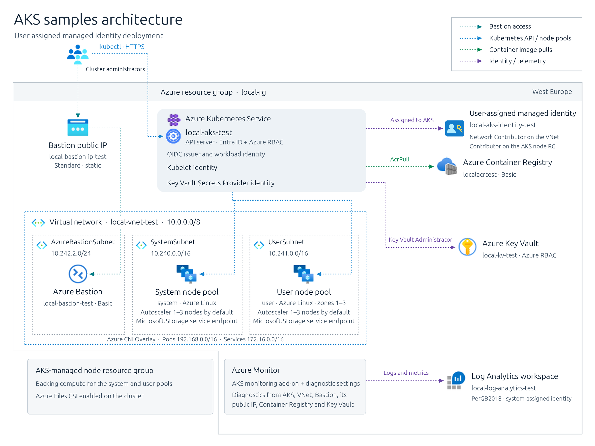

# Bicep Deployment

This directory contains the Bicep template and a deployment script that create the same Azure Kubernetes Service (AKS) cluster as [scripts/01-system-assigned-managed-identity.sh](../scripts/01-system-assigned-managed-identity.sh) or, with `identityType` set to `UserAssigned`, as [scripts/01-user-assigned-managed-identity.sh](../scripts/01-user-assigned-managed-identity.sh): the same resources, with the same names and defaults, including the [diagnostic settings](../scripts/README.md#monitoring). Every [sample](../samples/) runs on it. For the samples and the other ways to create the cluster, see the [README](../README.md) at the root of the repository.

## Architecture



[scripts/01-user-assigned-managed-identity.sh](../scripts/01-user-assigned-managed-identity.sh) deploys the AKS cluster that the [samples](../samples/) and [tutorials](../tutorials/) run on, together with the network, container registry, key vault and monitoring around it. [scripts/01-system-assigned-managed-identity.sh](../scripts/01-system-assigned-managed-identity.sh), [scripts/01-configurable-cluster.sh](../scripts/01-configurable-cluster.sh) with every default, and the [Bicep](./) and [Terraform](../terraform/) deployments create the same architecture. The Bicep and Terraform deployments use a user-assigned identity when `identityType` (Bicep) or `identity_type` (Terraform) is `UserAssigned`. With a system-assigned identity, Azure creates the cluster identity (item 6) together with the cluster. The architecture is composed of the following Azure resources:

1. [Azure Resource Group](https://learn.microsoft.com/azure/azure-resource-manager/management/manage-resource-groups-cli) `<prefix>-rg`: A logical container scoping the resources below. AKS creates a second one for the cluster's infrastructure, the node resource group (item 10).
2. [Azure Key Vault](https://learn.microsoft.com/azure/key-vault/general/overview) `<prefix>-kv-<suffix>` with the [Azure RBAC permission model](https://learn.microsoft.com/azure/key-vault/general/rbac-guide): A vault whose secrets pods can mount as files through the [Azure Key Vault Secrets Provider](https://learn.microsoft.com/azure/aks/csi-secrets-store-driver) add-on. The add-on's identity (item 10) holds [Key Vault Administrator](https://learn.microsoft.com/azure/role-based-access-control/built-in-roles/security#key-vault-administrator) on it. No sample needs it: [tutorials/key-vault-csi-driver](../tutorials/key-vault-csi-driver/) creates its own vault.
3. [Azure Log Analytics workspace](https://learn.microsoft.com/azure/azure-monitor/logs/log-analytics-overview) `<prefix>-log-analytics-<suffix>` (`PerGB2018` pricing tier, system-assigned identity): Stores the [Container Insights](https://learn.microsoft.com/azure/azure-monitor/containers/container-insights-overview) data of the cluster, such as the `ContainerLogV2`, `KubeEvents` and `KubePodInventory` tables, and the resource logs and metrics that [diagnostic settings](https://learn.microsoft.com/azure/azure-monitor/essentials/diagnostic-settings) named `default` send from the cluster, the virtual network, the Bastion host and its public IP address, the registry and the key vault. See [Monitoring](../scripts/README.md#monitoring).
4. [Azure Virtual Network](https://learn.microsoft.com/azure/virtual-network/virtual-networks-overview) `<prefix>-vnet-<suffix>` (`10.0.0.0/8`): Hosts three subnets:
   - *SystemSubnet* (`10.240.0.0/16`): The nodes of the system node pool.
   - *UserSubnet* (`10.241.0.0/16`): The nodes of the user node pool.
   - *AzureBastionSubnet* (`10.242.2.0/24`): The Bastion host.

   The two node subnets have the `Microsoft.Storage` [service endpoint](https://learn.microsoft.com/azure/virtual-network/virtual-network-service-endpoints-overview), so that in NFS mode the storage account of [web-app-file-storage](../samples/web-app-file-storage/) can accept traffic from the nodes only.
5. [Azure Bastion](https://learn.microsoft.com/azure/bastion/bastion-overview) `<prefix>-bastion-<suffix>` (Basic SKU), with the Standard static [public IP address](https://learn.microsoft.com/azure/virtual-network/ip-services/public-ip-addresses) `<prefix>-bastion-ip-<suffix>`: Reaches the nodes over SSH from the Azure portal, without exposing them to the internet.
6. [User-assigned managed identity](https://learn.microsoft.com/entra/identity/managed-identities-azure-resources/overview) `<prefix>-aks-identity-<suffix>`: The [cluster identity](https://learn.microsoft.com/azure/aks/use-managed-identity), which the control plane uses to manage the cluster's Azure resources. It is created before the cluster and assigned to it. It holds [Network Contributor](https://learn.microsoft.com/azure/role-based-access-control/built-in-roles/networking#network-contributor) on the virtual network and on *SystemSubnet*, which a cluster in a custom virtual network needs, and [Contributor](https://learn.microsoft.com/azure/role-based-access-control/built-in-roles/privileged#contributor) on the node resource group, which AKS grants.
7. [Azure Container Registry](https://learn.microsoft.com/azure/container-registry/container-registry-intro) `<prefix>acr<suffix>` (Basic SKU, admin user enabled): Stores the container images of the samples. It is [attached to the cluster](https://learn.microsoft.com/azure/aks/cluster-container-registry-integration): the kubelet identity (item 10) holds the [AcrPull](https://learn.microsoft.com/azure/role-based-access-control/built-in-roles/containers#acrpull) role on it, so the nodes pull the images without credentials.
8. [Azure Kubernetes Service (AKS) cluster](https://learn.microsoft.com/azure/aks/what-is-aks) `<prefix>-aks-<suffix>`, on the newest generally available Kubernetes version of the region:
   - [Azure CNI Overlay](https://learn.microsoft.com/azure/aks/azure-cni-overlay) networking: the nodes take their addresses from the subnets, the pods from `192.168.0.0/16` outside the virtual network, and the services from `172.16.0.0/16`, with the cluster DNS service at `172.16.0.10`. The [network policy](https://learn.microsoft.com/azure/aks/use-network-policies) is Azure, Cilium (with the Cilium data plane) or Calico, as chosen in the scripts' menu, the `networkOption` parameter in Bicep or the `network_option` variable in Terraform.
   - [Microsoft Entra ID authentication](https://learn.microsoft.com/azure/aks/enable-authentication-microsoft-entra-id) with [Azure RBAC for Kubernetes authorization](https://learn.microsoft.com/azure/aks/manage-azure-rbac): the members of the cluster's admin groups are cluster administrators, and any other user or identity needs an Azure Kubernetes Service RBAC role, such as Azure Kubernetes Service RBAC Cluster Admin. `kubectl` signs in with [kubelogin](https://learn.microsoft.com/azure/aks/kubelogin-authentication).
   - The [OIDC issuer](https://learn.microsoft.com/azure/aks/use-oidc-issuer) and [Microsoft Entra Workload ID](https://learn.microsoft.com/azure/aks/workload-identity-overview): a pod signs in to Azure services as a managed identity through a federated credential, without secrets. The samples that need it create their own identities and credentials.
   - Add-ons and features: Container Insights (the `monitoring` add-on), the Azure Key Vault Secrets Provider, [KEDA](https://learn.microsoft.com/azure/aks/keda-about), the [managed Gateway API](https://learn.microsoft.com/azure/aks/managed-gateway-api) CRDs, [Advanced Container Networking Services](https://learn.microsoft.com/azure/aks/advanced-container-networking-services-overview), and the [Azure Disk](https://learn.microsoft.com/azure/aks/azure-disk-csi) and [Azure Files](https://learn.microsoft.com/azure/aks/azure-files-csi) CSI drivers with the snapshot controller.
9. [Node pools](https://learn.microsoft.com/azure/aks/create-node-pools): the [system node pool](https://learn.microsoft.com/azure/aks/use-system-pools) `system` in *SystemSubnet*, created with the cluster, and the user node pool `user` in *UserSubnet*, spread across [availability zones](https://learn.microsoft.com/azure/aks/availability-zones) 1, 2 and 3. Both run [Azure Linux](https://learn.microsoft.com/azure/azure-linux/intro-azure-linux) on `Standard_D4ds_v5` virtual machines with 50 GiB [ephemeral OS disks](https://learn.microsoft.com/azure/aks/concepts-storage#ephemeral-os-disks-in-aks), up to 100 pods per node, and the [cluster autoscaler](https://learn.microsoft.com/azure/aks/cluster-autoscaler-overview) between 1 and 3 nodes.
10. [Node resource group](https://learn.microsoft.com/azure/aks/faq#why-are-two-resource-groups-created-with-aks-) `MC_<prefix>-rg_<prefix>-aks-<suffix>_<location>`, created and managed by AKS: Holds the virtual machine scale sets of the two node pools, the [Standard load balancer](https://learn.microsoft.com/azure/aks/load-balancer-standard) `kubernetes` with the public IP address of the cluster's outbound traffic, the network security group of the nodes, and the disks and storage accounts that the CSI drivers create for persistent volumes. It also holds two user-assigned managed identities: the kubelet identity `<prefix>-aks-<suffix>-agentpool`, which pulls the images from the registry (item 7), and `azurekeyvaultsecretsprovider-<prefix>-aks-<suffix>`, the identity of the Key Vault Secrets Provider (item 2).
11. [Data collection rule](https://learn.microsoft.com/azure/azure-monitor/essentials/data-collection-rule-overview) `MSCI-<location>-<prefix>-aks-<suffix>`, in the resource group, with its association to the cluster: Tells the Container Insights agent on the nodes what to collect, and sends the data to the workspace (item 3). The monitoring add-on creates it for the scripts; the Bicep and Terraform templates define it themselves.

Every deployment ends with `az aks get-credentials`, which merges the cluster into your kubeconfig. Each sample then pushes its image to the registry and deploys into its own namespace: the nodes pull the image through the kubelet identity, the samples that use Workload ID reach Azure services without secrets, and the logs of every pod land in the `ContainerLogV2` table of the workspace, where the KQL queries in the sample READMEs read them.

In this directory, [`deploy.sh`](deploy.sh) creates the resource group (item 1), and [`main.bicep`](main.bicep) deploys the other resources through these modules: `log-analytics.bicep` (item 3), `key-vault.bicep` (item 2), `container-registry.bicep` (item 7), `virtual-network.bicep` (item 4), `bastion-host.bicep` (item 5), `managed-identity.bicep` (item 6, with `identityType` set to `UserAssigned`), `aks-cluster.bicep` (item 8 with the `system` node pool, and item 11) and `aks-node-pool.bicep` (the `user` node pool). Each module also creates the `default` diagnostic settings of its resources, and `main.bicep` creates the role assignments.

## Prerequisites

- [LocalStack for Azure](https://docs.localstack.cloud/azure/), or an Azure subscription
- [Docker](https://docs.docker.com/get-docker/)
- [Azure CLI](https://learn.microsoft.com/en-us/cli/azure/install-azure-cli), which installs Bicep on first use, and the [lstk CLI](https://docs.localstack.cloud/aws/developer-tools/running-localstack/lstk/)
- [kubectl](https://kubernetes.io/docs/tasks/tools/), and on Azure [kubelogin](https://learn.microsoft.com/en-us/azure/aks/kubelogin-authentication) (`az aks install-cli` installs both)
- [Visual Studio Code](https://code.visualstudio.com/) + [Bicep extension](https://marketplace.visualstudio.com/items?itemName=ms-azuretools.vscode-bicep), optional

```bash
brew install localstack/tap/lstk   # or: npm install -g @localstack/lstk
```

## Configuration

[`main.bicepparam`](main.bicepparam) holds the scripts' defaults:

```bicep
using 'main.bicep'

param prefix = 'local'
param suffix = 'test'
param identityType = 'SystemAssigned'
param networkOption = 1
param systemNodeCount = 1
param userNodeCount = 1
param nodeVmSize = 'Standard_D4ds_v5'
param osSku = 'AzureLinux'
param osDiskSizeGB = 50
param osDiskType = 'Ephemeral'
param maxPods = 100
param windowsAdminUsername = 'azadmin'

param windowsAdminPassword = readEnvironmentVariable('WINDOWS_ADMIN_PASSWORD')
```

`deploy.sh` passes the parameters below on the command line, from environment variables that default to the scripts' values. The scripts ask for the network option and the node counts; here they come from the environment:

| Environment variable | Parameter | Default | Script variable |
| -------------------- | --------- | ------- | --------------- |
| `PREFIX` | `prefix` | `local` | `prefix` |
| `SUFFIX` | `suffix` | `test` | `suffix` |
| `LOCATION` | `location` | `westeurope` | `location` |
| `IDENTITY_TYPE` | `identityType` | `SystemAssigned` | The choice of script |
| `NETWORK_OPTION` | `networkOption` | `1` | The network plugin and policy menu: `1` Azure CNI Overlay with the Azure network policy, `2` with the Cilium dataplane and network policy, `3` with the Calico network policy |
| `SYSTEM_NODE_COUNT` | `systemNodeCount` | `1` | `node_count`, asked by the scripts |
| `USER_NODE_COUNT` | `userNodeCount` | `1` | `node_pool_node_count`, asked by the scripts |
| `AAD_ADMIN_GROUP_OBJECT_IDS` | `aadAdminGroupObjectIds` | `<your-admin-group-object-id>` | `aad_profile_admin_group_object_ids` |
| `SSH_PUBLIC_KEY_FILE` | `sshPublicKey`, the file's content | `~/.ssh/id_rsa.pub` | `ssh_key_value` |
| `WINDOWS_ADMIN_PASSWORD` | `windowsAdminPassword` | The scripts' password | `windows_admin_password` |
| | `kubernetesVersion` | The latest GA version in the region | `kubernetes_version` |

The autoscaler range of each node pool is 1 to 3 nodes, widened to include the node count, as in the scripts. The admin group placeholder works on the emulator; on Azure, set `AAD_ADMIN_GROUP_OBJECT_IDS` to the comma-separated object IDs of real Microsoft Entra ID groups. The registry and key vault names are globally unique on Azure, so export your own `SUFFIX` there.

## Deployment

```bash
# the cluster of scripts/01-system-assigned-managed-identity.sh
./deploy.sh

# the cluster of scripts/01-user-assigned-managed-identity.sh, with the Cilium dataplane and network policy
IDENTITY_TYPE=UserAssigned NETWORK_OPTION=2 ./deploy.sh

# preview the changes of a re-deployment instead of validating the template
USE_WHAT_IF=1 ./deploy.sh
```

The script will:

1. Look up the latest GA Kubernetes version in the region.
2. Ensure the resource group exists.
3. Validate `main.bicep` (or run a what-if with `USE_WHAT_IF=1`; `VALIDATE_TEMPLATE=0` skips both).
4. Deploy the template, passing the parameters above.
5. Configure `kubectl` for the cluster with `az aks get-credentials`.
6. Print the cluster's storage profile and storage classes, as the scripts do.

Then deploy the samples as their READMEs describe, as on a cluster created by the scripts.

## Verification

```bash
# the diagnostic settings of the cluster's resources
../tests/test-diagnostic-settings.sh

# the cluster and its node pools
az aks show --name local-aks-test --resource-group local-rg \
  --query "{identity: identity.type, network: networkProfile.networkPolicy, gatewayApi: ingressProfile}" --output json
az aks nodepool list --cluster-name local-aks-test --resource-group local-rg \
  --query "[].{name: name, mode: mode, count: count, zones: availabilityZones}" --output table
kubectl get nodes
```

## LocalStack emulator notes

The template deploys on the emulator as it is, and the cluster it creates there matches the one the scripts create: the same resources, cluster settings, node pools, role assignments and diagnostic settings.

## Related Documentation

- [Microsoft.ContainerService managedClusters (Bicep)](https://learn.microsoft.com/en-us/azure/templates/microsoft.containerservice/managedclusters)
- [Microsoft.Insights diagnosticSettings (Bicep)](https://learn.microsoft.com/en-us/azure/templates/microsoft.insights/diagnosticsettings)
- [Monitor AKS: resource logs](https://learn.microsoft.com/en-us/azure/aks/monitor-aks#azure-monitor-resource-logs)
- [LocalStack for Azure Documentation](https://docs.localstack.cloud/azure/)
- [lstk CLI](https://docs.localstack.cloud/aws/developer-tools/running-localstack/lstk/)
