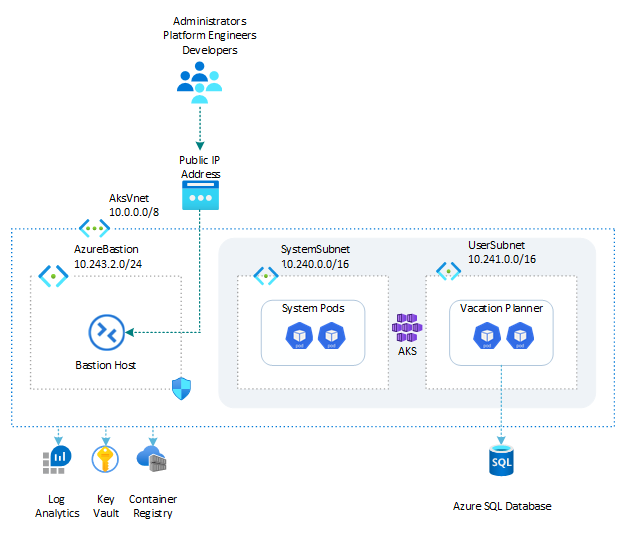

# Vacation Planner: Azure SQL Database

> A .NET version of this sample lives in [../dotnet](../dotnet/README.md).

This sample demonstrates a Python Flask single-page web application called *Vacation Planner* hosted on an [Azure Kubernetes Service (AKS)](https://learn.microsoft.com/en-us/azure/aks/what-is-aks) cluster in the cloud on Azure or locally in the LocalStack emulator for Azure. The app runs in a dedicated namespace and stores activity data in the `dbo.Activities` table of the `PlannerDB` database on an [Azure SQL Database](https://learn.microsoft.com/en-us/azure/azure-sql/database/sql-database-paas-overview).

The application connects to Azure SQL using a dedicated SQL login (rather than the server admin), and the deployment scripts seed the `Activities` table with a handful of sample plans so the app shows data on first load.

> [!NOTE]
> Each logical server you create runs a Microsoft SQL Server container, so you must accept the [SQL Server End-User Licensing Agreement](https://go.microsoft.com/fwlink/?LinkId=746388) before the emulator provisions one.
> Start the emulator with `MSSQL_ACCEPT_EULA` set to `Y`:
> 
> ```bash
> LOCALSTACK_MSSQL_ACCEPT_EULA=Y lstk start --type azure
> ```
> 
> Host variables prefixed with `LOCALSTACK_` are forwarded to the emulator, so the container receives `MSSQL_ACCEPT_EULA=Y`.
> 
> To accept it once rather than on every start, add it to an environment profile in your `lstk` config:
> 
> ```toml
> [[containers]]
> type = "azure"
> tag  = "latest"
> port = "4566"
> env  = ["mssql"]
> 
> [env.mssql]
> MSSQL_ACCEPT_EULA = "Y"
> ```
> 
> A profile's values are injected into the container directly, so the `LOCALSTACK_` prefix is not used here.
> `lstk` reads the first `config.toml` it finds, starting with `./.lstk/config.toml` in the current directory and then `$HOME/.config/lstk/config.toml`.
> See [Config file search order](https://docs.localstack.cloud/azure/developer-tools/running-localstack/lstk/configuration/#config-file-search-order) for the full list and [Passing environment variables to the container](https://docs.localstack.cloud/azure/developer-tools/running-localstack/lstk/configuration/#passing-environment-variables-to-the-container) for how profiles work.
> 
> If you start the emulator with the `docker` CLI or Docker Compose, set `MSSQL_ACCEPT_EULA=Y` directly in the container environment instead.
> Without it, `az sql server create` fails with `(EulaNotAccepted)`.

Before installing the sample, make sure to create an [Azure Kubernetes Service (AKS)](https://learn.microsoft.com/en-us/azure/aks/what-is-aks) cluster by using one of the following scripts:

- [scripts/01-system-assigned-managed-identity.sh](../../../scripts/01-system-assigned-managed-identity.sh): creates the cluster using a system-assigned managed identity as its cluster identity.
- [scripts/01-user-assigned-managed-identity.sh](../../../scripts/01-user-assigned-managed-identity.sh): creates the cluster using a user-assigned managed identity as its cluster identity.

All commands below are run from this sample's `scripts/` folder.

> **Running on LocalStack?** Install the [lstk CLI](https://docs.localstack.cloud/aws/developer-tools/running-localstack/lstk/) and run `lstk az start-interception` to route Azure CLI calls to the emulator. See [Run against LocalStack](../../../README.md#run-against-localstack) for the full setup.

## Architecture

The following diagram illustrates the architecture of the solution:



## Deployment workflow

Run the numbered scripts in order from the `scripts/` folder:

```bash
cd scripts
./01-deploy-resources.sh
./02-build-docker-image.sh
./03-run-docker-container.sh   # optional local smoke test
./04-push-docker-image.sh
./05-deploy-app.sh
```

## Scripts and manifests

| File | Description |
| ---- | ----------- |
| [`00-variables.sh`](scripts/00-variables.sh) | Defines the variables shared across the other scripts (resource names, image tag, SQL credentials, Kubernetes namespace, …). The other scripts load these values by sourcing this file. |
| [`01-deploy-resources.sh`](scripts/01-deploy-resources.sh) | Deploys the Azure resources used by this sample: the resource group, the [Azure Container Registry (ACR)](https://learn.microsoft.com/en-us/azure/container-registry/container-registry-intro), the [Azure SQL Database](https://learn.microsoft.com/en-us/azure/azure-sql/database/sql-database-paas-overview) logical server and database, a permissive firewall rule (dev/test only), a dedicated SQL login and database user with the appropriate roles, and the `Activities` table, which it also seeds with sample data. Requires `sqlcmd` on the host. |
| [`02-build-docker-image.sh`](scripts/02-build-docker-image.sh) | Builds the Docker image for the web app from the [`src/`](src/) folder. |
| [`03-run-docker-container.sh`](scripts/03-run-docker-container.sh) | Runs the web app in a local Docker container (no Kubernetes) to validate that it starts and connects to the database as expected. |
| [`04-push-docker-image.sh`](scripts/04-push-docker-image.sh) | Tags and pushes the Docker image to the Azure Container Registry, on Azure or in the LocalStack emulator. |
| [`05-deploy-app.sh`](scripts/05-deploy-app.sh) | Uses the YAML manifests below (templated with `yq`) to deploy the app to the AKS cluster. |
| [`Dockerfile`](scripts/Dockerfile) | Builds the Docker image of the web app. |
| [`namespace.yml`](scripts/namespace.yml) | Creates the Kubernetes namespace. |
| [`configmap.yml`](scripts/configmap.yml) | Creates the ConfigMap holding non-secret input values (SQL server FQDN, database, username, login name) passed to the app as environment variables. |
| [`secret.yml`](scripts/secret.yml) | Creates the Secret holding sensitive values (the SQL password and the Flask secret key) passed to the app as environment variables. |
| [`deployment.yml`](scripts/deployment.yml) | Creates the Kubernetes Deployment, including the pod specification for the web app. The liveness and readiness probes call `GET /health`. |
| [`service.yml`](scripts/service.yml) | Creates the `ClusterIP` Service that exposes the web app inside the cluster. |

## Accessing the web app

The app is exposed through a `ClusterIP` service, which is only reachable from inside the cluster. Port-forward it to a local port to open it from your machine:

```bash
kubectl port-forward service/vacation-planner-sql 8080:80 -n vacation-planner-sql
```

Then browse to [http://localhost:8080](http://localhost:8080). Alternatively, use a tool such as [k9s](https://k9scli.io/) to start the port-forward interactively.

The app also exposes `GET /health`, the endpoint the liveness and readiness probes call: it returns `{"status": "ok"}` when the Azure SQL database is reachable and `503` with `{"status": "unavailable"}` otherwise.

```bash
curl http://localhost:8080/health
```

## Logs

The app logs one line per request — gunicorn writes an access log line for every call, the probes included, because its command passes `--access-logfile -` — plus one line per database read and write and one line for every activity added, updated, deleted or retrieved (see [Query the logs with KQL](#query-the-logs-with-kql)). Every entry carries a timestamp, the logger name and the level; the Azure SDK and `urllib3` stay at warning level. The [.NET version](../dotnet/README.md) writes the same trace.

```bash
kubectl logs deployment/vacation-planner-sql -n vacation-planner-sql --tail=50
```

## Query the logs with KQL

The cluster scripts listed at the top of this page enable the monitoring add-on, so Container Insights collects the containers' logs and the cluster's inventory, events and metrics in the Log Analytics workspace they create (`local-log-analytics-test` in `local-rg`, with the default names). The [Bicep](../../../bicep/README.md) and [Terraform](../../../terraform/README.md) templates enable it too, and [scripts/01-configurable-cluster.sh](../../../scripts/01-configurable-cluster.sh) enables it unless you turn monitoring off. [scripts/01-basic-cluster.sh](../../../scripts/01-basic-cluster.sh) doesn't.

To explore the data, open the Log Analytics workspace in the [Azure Portal Emulator](https://docs.localstack.cloud/azure/developer-tools/portal/) or in the Azure portal, select **Logs** in the navigation bar, and run queries written in the [Kusto Query Language (KQL)](https://docs.localstack.cloud/azure/developer-tools/kusto-query-language/). On Azure, new rows can take a few minutes to arrive. The same queries run from the command line through the Azure CLI's `log-analytics` extension (`az extension add --name log-analytics`):

```bash
workspace_id=$(az monitor log-analytics workspace show \
  --resource-group local-rg \
  --workspace-name local-log-analytics-test \
  --query customerId \
  --output tsv)

az monitor log-analytics query \
  --workspace "$workspace_id" \
  --analytics-query 'ContainerLogV2 | where LogMessage has "Activity" | take 20' \
  --output table
```

Container Insights writes these tables:

- **ContainerLogV2**: Recommended table (replacing the legacy ContainerLog) containing the stdout and stderr logs emitted by containers. It offers improved schemas and support for multi-line logs.
- **KubeEvents**: Collects native Kubernetes events generated within the cluster (e.g., pod scheduling, crashes, restarts).
- **KubePodInventory**: Information about the status and lifecycle of the cluster's pods (Ready, Failed, Pending, etc.).
- **ContainerInventory**: Tracks the status of individual containers (e.g., images used, execution status, container ID).
- **ContainerNodeInventory**: Information and status of the worker nodes (VMs or VMSSs) that make up the node pools.
- **InsightsMetrics**: Metrics about deployments, the kubelets and scraped Prometheus endpoints. On Azure it also holds the nodes' disk and network metrics, which the emulator doesn't produce. CPU and memory usage are in Perf.
- **Perf**: CPU and memory usage, requests and limits of the nodes and containers.
- **KubeServices**: Tracks the inventory of Kubernetes services (ClusterIP, NodePort, LoadBalancer).
- **KubeNodeInventory**: The nodes as Kubernetes sees them: status, labels and Kubernetes version.
- **KubePVInventory**: Persistent volumes and their claims.
- **KubeMonAgentEvents**: Diagnostic events related to the monitoring agent itself. Empty on the emulator, which runs no agent.

Every activity operation writes one line in the form `Activity <operation>: <details>`, where the operation is `added`, `updated`, `deleted` or `retrieved`:

```text
Activity added: Go to Viareggio
Activity updated: Go to Lucca (id 6f1c2a…)
Activity deleted: 6f1c2a…
Activity retrieved: 4 activities
```

ContainerLogV2 infers each line's `LogLevel` from its text, so these lines are stored at the `info` level, and a line that names no level is stored as `unknown`.

Kubernetes events by kind and reason:

```kusto
KubeEvents
| summarize EventCount = count() by ObjectKind, Reason
| sort by EventCount desc
```

Kubernetes events per minute by reason:

```kusto
KubeEvents
| summarize EventCount = count() by bin(TimeGenerated, 1m), Reason
| render timechart with (title="Kubernetes events by reason")
```

Pods and containers over time:

```kusto
union
    (KubePodInventory
    | summarize Count = dcount(PodUid) by bin(TimeGenerated, 1m)
    | extend Series = "Pods"),
    (ContainerInventory
    | summarize Count = dcount(ContainerID) by bin(TimeGenerated, 1m)
    | extend Series = "Containers")
| render timechart with (title="Pod vs. Container Count in the AKS Cluster")
```

Nodes over time:

```kusto
ContainerNodeInventory
| summarize NodeCount = dcount(Computer) by bin(TimeGenerated, 1m)
| render timechart with (title="Node Count in the AKS Cluster")
```

Log lines by container and level in the last two hours:

```kusto
ContainerLogV2
| where TimeGenerated > ago(2h)
| where PodNamespace != "kube-system"
| extend Level = toupper(LogLevel)
| summarize Count = count() by ContainerName, Level
| render barchart with (kind=stacked, title="Log Output by Container and Level")
```

Activities added, with the pod that served each request:

```kusto
ContainerLogV2
| where LogMessage contains "Activity added"
| project TimeGenerated, PodName, LogMessage
```

Activity operations:

```kusto
ContainerLogV2
| where LogMessage has_any ("added", "updated", "deleted", "retrieved")
| parse tostring(LogMessage) with * "Activity " Operation ": " Details
| where Operation in ("added", "updated", "deleted", "retrieved")
| project TimeGenerated, PodName, Operation, Details
```

Activity operations per minute by type:

```kusto
ContainerLogV2
| where LogMessage has_any ("added", "updated", "deleted", "retrieved")
| parse tostring(LogMessage) with * "Activity " Operation ": " *
| where Operation in ("added", "updated", "deleted", "retrieved")
| summarize Count = count() by bin(TimeGenerated, 1m), Operation
| render columnchart with (kind=stacked, title="Operations by type")
```
