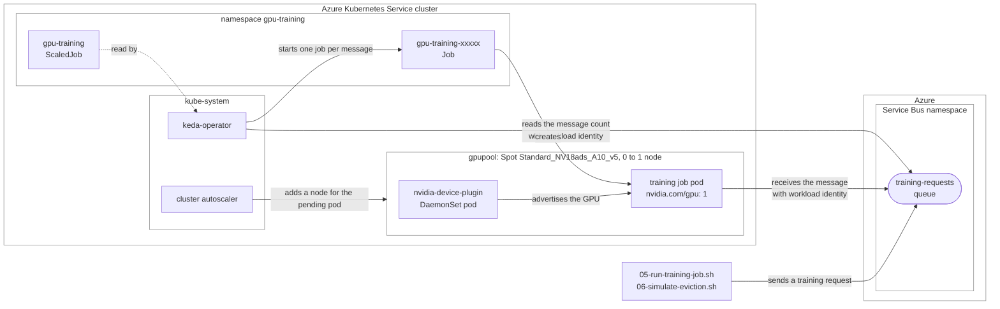

## Run GPU training jobs on a Spot GPU node pool that scales from zero

[Azure Kubernetes Service (AKS)](https://learn.microsoft.com/en-us/azure/aks/what-is-aks) runs GPU workloads on node pools of [NVIDIA GPU VM sizes](https://learn.microsoft.com/en-us/azure/aks/use-nvidia-gpu). A pool of [Spot VMs](https://learn.microsoft.com/en-us/azure/aks/spot-node-pool) makes them much cheaper, at the price of evictions whenever Azure needs the capacity back, and the [cluster autoscaler](https://learn.microsoft.com/en-us/azure/aks/cluster-autoscaler-overview) lets such a pool start with no node at all and grow only when a pod asks for a GPU.

This tutorial adds a Spot GPU node pool that scales from zero to a cluster, and runs training jobs on it: [KEDA](https://keda.sh/) starts a Kubernetes Job for each training request on an [Azure Service Bus](https://learn.microsoft.com/en-us/azure/service-bus-messaging/service-bus-messaging-overview) queue, the job's pod asks for one GPU, the cluster autoscaler adds a GPU node for it, and the pod trains a small [PyTorch](https://pytorch.org/) model. A second run simulates the eviction of the Spot node while a job trains, and the job completes on the node that replaces it. It runs unchanged against Azure in the cloud and against the [LocalStack for Azure](https://docs.localstack.cloud/azure/) emulator.

On Azure the job trains on the node's NVIDIA GPU. On the emulator, GPU nodes advertise the GPUs of their VM size without a GPU behind them: the pods schedule exactly as on AKS, and PyTorch finds no CUDA device, so the job trains on the CPU. That is enough to develop and test the scheduling, the scaling and the eviction handling on a machine without a GPU. See [Run GPU workloads](https://docs.localstack.cloud/azure/services/aks/#run-gpu-workloads) in the emulator's documentation.

> **Running on LocalStack?** Install the [lstk CLI](https://docs.localstack.cloud/aws/developer-tools/running-localstack/lstk/) and run `lstk az start-interception` to route Azure CLI calls to the emulator. See [Run against LocalStack](../../README.md#run-against-localstack) for the full setup.

## Architecture

The GPU node pool joins the cluster's system and user pools with no node. KEDA watches the queue and starts a job for each message; the job's pod is the only workload that tolerates the GPU pool's taints and asks for a GPU, so the cluster autoscaler adds a node to that pool, and only to that pool, to run it.



## Prerequisites

- An AKS cluster reachable through `kubectl`, created with [scripts/01-user-assigned-managed-identity.sh](../../scripts/01-user-assigned-managed-identity.sh) (or the system-assigned variant), which enables the KEDA add-on, the OIDC issuer and workload identity. The values in [scripts/00-variables.sh](scripts/00-variables.sh) (cluster `local-aks-test`, resource group `local-rg`, location `ItalyNorth`) must match the cluster those scripts create; edit them if you changed their `prefix`, `suffix` or `location`.
- On Azure, Spot capacity and quota for one `Standard_NV18ads_A10_v5` node: 18 vCPUs of the region's Spot quota, which every VM family shares. Check it with `az vm list-usage --location italynorth --query "[?name.value=='lowPriorityCores']" --output table`. When Azure has no Spot capacity for the size, the job's pod stays pending, and `05-run-training-job.sh` prints the cluster autoscaler's status when it gives up waiting.
- [Azure CLI](https://learn.microsoft.com/en-us/cli/azure/install-azure-cli) (`az`), authenticated with `az login`. Running against LocalStack? Point the CLI at the emulator first, then run the same scripts unchanged.
- [kubectl](https://kubernetes.io/docs/tasks/tools/), [yq](https://github.com/mikefarah/yq), used to fill the manifests in with the values from `00-variables.sh`, and [jq](https://jqlang.org/), `curl` and `openssl`, used to send the training requests and to print the GPU node.

## How to run it

Run the numbered scripts in order. Each one sources [00-variables.sh](scripts/00-variables.sh), and the setup scripts (`01` to `04`) are idempotent, so they can be re-run safely.

| Script | What it does | Expected result |
| --- | --- | --- |
| `00-variables.sh` | Variables for this tutorial (the GPU node pool, the device plugin, Service Bus, the managed identity and the training job). Sourced by every script, never run directly. | Variables set. |
| `functions.sh` | The functions the scripts share: reading the Service Bus endpoints, sending a training request, and following the jobs. Sourced by `04` to `06`. | Functions defined. |
| `01-add-gpu-node-pool.sh` | Verifies the cluster exists with its OIDC issuer, enables the KEDA add-on if needed, merges the cluster credentials into `kubeconfig` (run it first), and adds the Spot GPU node pool with no node and the cluster autoscaler from 0 to 1 node. | The pool exists with `count: 0`, `scaleSetPriority: Spot` and the Spot label and taint AKS adds, and no node. |
| `02-deploy-device-plugin.sh` | Deploys the NVIDIA device plugin DaemonSet from Microsoft's guide, selecting the nodes AKS labels `accelerator=nvidia` and tolerating the GPU pool's taints. | The DaemonSet exists and schedules no pod until a GPU node joins. |
| `03-create-resources.sh` | Creates (or reuses) the Service Bus namespace, the `training-requests` queue and the managed identity, grants the identity the **Azure Service Bus Data Owner** role on the namespace, federates it with the KEDA operator and with the training job's service account, and binds the operator to it. | The resources and the role assignment exist. The operator restart is skipped when the binding is already in place. |
| `04-deploy-scaled-job.sh` | Creates the `gpu-training` namespace, the job's service account bound to the identity, the training script as a config map, the `TriggerAuthentication` and the `ScaledJob`, deriving the Service Bus endpoints at apply time. | The `ScaledJob` is `Ready`. |
| `05-run-training-job.sh` | Sends a training request, waits for KEDA to start a job and for the cluster autoscaler to add a GPU node for its pod, prints the node's AKS labels, taints and GPU, and waits for the job to complete. | The job completes; its log says whether PyTorch found CUDA and how many steps it trained. |
| `06-simulate-eviction.sh` | Sends a longer training request and, once its pod reports training progress, simulates the eviction of its Spot node with `az vmss simulate-eviction`, follows the node until AKS deletes it, and waits for the job to complete on a new node. | The node is tainted for the eviction and deleted, and the job completes on another node. |
| `07-cleanup.sh` | Deletes the two namespaces, the GPU node pool, the Service Bus namespace with the identity's role on it, and the identity's federation with the training job. | Everything the tutorial created is gone; the identity and the operator binding stay for the KEDA tutorials, which share them. |

```bash
cd gpu-node-pools/scripts
./01-add-gpu-node-pool.sh
./02-deploy-device-plugin.sh
./03-create-resources.sh
./04-deploy-scaled-job.sh
./05-run-training-job.sh
./06-simulate-eviction.sh
# ./07-cleanup.sh   # when finished
```

> [!NOTE]
> The first time you run the tutorial, the job's pod can take a few minutes to start running: the new GPU node has to download the pod's image, `pytorch/pytorch:2.5.1-cuda12.4-cudnn9-runtime` (about 3 GB), which can take between 5 and 10 minutes depending on your network bandwidth.
> Until the download completes, the pod stays `Pending`, and `05-run-training-job.sh` keeps printing `(pods: Pending)`.
> Every node the cluster autoscaler adds to the GPU pool starts without the image, so the wait comes back whenever a run finds the pool scaled back to zero, and in `06-simulate-eviction.sh` for the node that replaces the evicted one.
> To check that the pod is downloading its image rather than stuck, run `kubectl get events --namespace gpu-training --watch` in another terminal: it shows `Pulling image` when the download starts and `Successfully pulled image` when it ends.

### Kubernetes manifests

Every manifest in [scripts/](scripts/) is valid, applyable YAML whose environment-specific fields are empty strings; the scripts fill them in with `yq`, which is why the same files work against the emulator and against Azure without edits.

| Manifest | What it creates | Filled in at apply time |
| --- | --- | --- |
| `nvidia-device-plugin.yml` | The `nvidia-device-plugin-daemonset` DaemonSet, with `FAIL_ON_INIT_ERROR=false` so that the plugin waits instead of exiting on a node without a usable GPU. | The name, the namespace, the image and the tolerations. |
| `serviceaccount.yml` | `gpu-training`, the job's service account, annotated with the managed identity's client id. | The name, the namespace and the client id. |
| `triggerauthentication.yml` | `gpu-training-trigger-auth`, which tells KEDA to read the queue as the managed identity with workload identity. | The name, the namespace and the client id. |
| `scaledjob.yml` | `gpu-training`, the `ScaledJob`: one job per message, a pod that asks for one GPU, selects the GPU pool's nodes and tolerates their taints. | The image, the Service Bus host and custom endpoint, the queue, the resources, the tolerations and the scaler's `endpointSuffix`. |

### Application

| Path | What it is |
| --- | --- |
| `src/train.py` | The training job. It receives one message with `DefaultAzureCredential`, which signs in with the pod's workload identity, reads `train_seconds` from it, and trains a small model with PyTorch on `cuda` when `torch.cuda.is_available()`, on `cpu` otherwise, printing its progress every 30 seconds. |

The job runs the official PyTorch image with CUDA (`pytorch/pytorch:2.5.1-cuda12.4-cudnn9-runtime`, about 3 GB, so the first pod on each new node spends a few minutes pulling it), and installs `azure-servicebus`, `azure-identity` and `websocket-client` into `/tmp` when it starts. The pod runs as a non-root user with a read-only root file system, so the libraries go to an `emptyDir` volume.

## How it works

**A pool that scales from zero.** The GPU pool is created with `--node-count 0 --min-count 0 --max-count 1 --enable-cluster-autoscaler`. While no pod needs it, it has no node and costs nothing. The job's pod requests `nvidia.com/gpu: 1`, selects `workload: gpu` and tolerates the pool's `sku=gpu:NoSchedule` taint and the Spot taint, so no existing node can run it. The cluster autoscaler checks which pools could, finds the GPU pool, and adds a node to it. Once the job is done, it removes the node again after the node has been unneeded for a while: 10 minutes by default on AKS (the `scale-down-unneeded-time` of the [autoscaler profile](https://learn.microsoft.com/en-us/azure/aks/cluster-autoscaler#use-the-cluster-autoscaler-profile)), 30 seconds on the emulator.

**The labels and taints AKS sets.** AKS labels every node of an NVIDIA GPU size `accelerator=nvidia`, and every node of a Spot pool `kubernetes.azure.com/scalesetpriority=spot`, with the matching `NoSchedule` taint, whether or not the pool declares them. The device plugin DaemonSet selects the first, so it runs only on GPU nodes; the job tolerates the second, since only workloads that can handle an eviction belong on Spot nodes.

**Why the device plugin.** AKS installs the NVIDIA driver on the nodes of a GPU size, but Kubernetes learns about their GPUs only from a device plugin. Until the plugin runs on a node, the node advertises no `nvidia.com/gpu`, and a pod that asks for one can't be scheduled there. This tutorial deploys the plugin's DaemonSet as Microsoft's guide does. AKS can also install it for you on [AKS-managed GPU node pools](https://learn.microsoft.com/en-us/azure/aks/aks-managed-gpu-nodes).

**One job per message.** The `ScaledJob` declares an `azure-servicebus` trigger with `messageCount: "1"`: every polling interval, KEDA starts as many jobs as there are messages waiting, up to `maxReplicaCount`. Each job's pod receives one message and deletes it, so a request is processed once.

**The eviction.** `az vmss simulate-eviction` evicts a Spot instance the way Azure does when it needs the capacity back. AKS taints the node `remediator.kubernetes.azure.com/unschedulable:NoSchedule`, evicts its pods and deletes the node with its scale set instance. The job's pod is gone, so the Job starts a replacement, which stays pending until the cluster autoscaler adds a new node, and completes there. The first pod had already received and deleted the message, so the replacement pod finds the queue empty and trains for the default time (`JOB_DEFAULT_TRAIN_SECONDS`). A production job would rather keep its message locked until it finishes, or checkpoint its training, so that a replacement pod picks up where the evicted one stopped.

**How KEDA and the job authenticate.** The managed identity is federated with two service accounts: `keda-operator` in `kube-system`, so the operator can read the queue's message count, and the job's `gpu-training`, so the pod can receive a message. Both exchange their projected service account token for a Microsoft Entra token for the identity, and the **Azure Service Bus Data Owner** role on the namespace, granted on the identity's principal (object) id, authorizes them. No secret is involved, except the namespace key the scripts use on your machine to send the training requests over the HTTPS API.

**Why the job may use a custom endpoint.** On Azure the job connects to `{namespace}.servicebus.windows.net` over AMQP on port 5671, and `SERVICE_BUS_CUSTOM_ENDPOINT` is empty. On the emulator, the namespace's AMQP endpoint has its own port, which [04-deploy-scaled-job.sh](scripts/04-deploy-scaled-job.sh) reads from the namespace's `serviceBusEndpoint` and passes as a custom endpoint address. With a custom endpoint, the Python Service Bus library uses AMQP over WebSockets, which needs the `websocket-client` package: that is why the job installs it. The KEDA scaler, for its part, reads the message count over the HTTPS API, served on the Azure Resource Manager port: 443 on Azure, the gateway port on the emulator. Hence the trigger's `cloud: Private` and its derived `endpointSuffix`, as in the [KEDA Service Bus tutorial](../keda/service-bus/).

## Resources

- [Use GPUs for compute-intensive workloads on AKS](https://learn.microsoft.com/en-us/azure/aks/use-nvidia-gpu)
- [Add an Azure Spot node pool to an AKS cluster](https://learn.microsoft.com/en-us/azure/aks/spot-node-pool)
- [Cluster autoscaling in AKS](https://learn.microsoft.com/en-us/azure/aks/cluster-autoscaler-overview)
- [Simulate an eviction of an Azure Spot VM](https://learn.microsoft.com/en-us/azure/virtual-machine-scale-sets/use-spot#simulate-an-eviction)
- [KEDA ScaledJobs](https://keda.sh/docs/2.20/concepts/scaling-jobs/) and the [Azure Service Bus scaler](https://keda.sh/docs/2.20/scalers/azure-service-bus/)
- [Securely scale your applications using the KEDA add-on and workload identity](https://learn.microsoft.com/en-us/azure/aks/keda-workload-identity)
- [NVIDIA device plugin for Kubernetes](https://github.com/NVIDIA/k8s-device-plugin)
- [LocalStack for Azure: Run GPU workloads on AKS](https://docs.localstack.cloud/azure/services/aks/#run-gpu-workloads)
